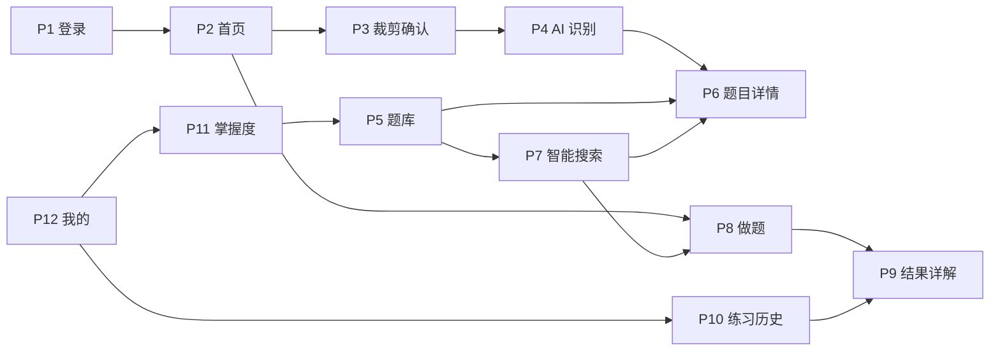

# 《学霸省题》产品需求文档（PRD）

> 文档版本：v1.1（已确认）  
> 编制日期：2026-08-24  
> 产品标识：`mistake-master`  
> 微信小程序 AppID：`wx7d9c6a2740751b9d`  
> 需求依据：`页面关系.md`、`学霸错题本.md`、`原型图/` 下 12 张高保真原型

## 1. 文档目的

本文档定义《学霸省题》微信小程序首个版本的产品范围、页面行为、业务规则、数据口径和验收标准，作为产品确认、技术设计、开发与测试的共同基线。

本版本严格遵循最小化开发原则：仅实现现有需求与原型明确表达的功能，不增加社交、排行榜、付费、教师端、后台管理、消息运营、题目分享等扩展能力。

## 2. 产品概述

### 2.1 产品定位

《学霸省题》是一款面向学生的个人错题学习微信小程序。用户通过拍照收集错题，系统利用 AI 将图片整理为结构化错题并写入个人知识库；用户可检索、复习、标记掌握状态，并通过每组最多 10 道推荐选择题完成巩固练习和结果复盘。

### 2.2 核心价值

1. 降低错题录入成本：拍照、裁剪、识别、解析、入库形成闭环。
2. 提高复习针对性：只基于当前用户自己的错题和薄弱知识点推荐练习。
3. 强化错误反馈：练习完成后逐题显示正误、正确答案、解析和易错点。
4. 沉淀个人知识库：每次上传都会增加可检索、可推荐、可统计的错题知识。

### 2.3 目标用户

- 需要整理数学或英语错题的学生。
- 希望利用碎片时间复习个人错题的学生。
- 希望查看练习记录和知识点掌握情况的学生。

### 2.4 首版成功标准

- 用户能够完成“微信登录 → 拍照上传 → AI 识别 → 保存 → 查看详情”的完整链路。
- 用户拥有至少 1 道可练习错题时即可开始练习；不足 10 道时全部展示，达到或超过 10 道时每组展示 10 道。
- 提交后统计结果准确，错误题有醒目标记，并可查看解析与易错点。
- 用户只能检索、查看和练习自己的错题数据。
- 12 个原型页面的主要内容、状态和跳转均可正常使用。

## 3. 产品范围

### 3.1 本期范围

- 微信一键登录。
- 数学、英语科目切换。
- 首页学习数据与最近错题。
- 相机/相册选图、裁剪、AI 识别、结构化解析、保存错题。
- 错题列表、筛选、详情、掌握状态和加入练习。
- 基于个人错题知识库的语义搜索。
- 基于个人错题的每日推荐练习，每组 1–10 道，覆盖已支持录入的全部题型。
- 练习提交、判分、逐题详解、错题重做。
- 练习历史和知识点掌握度。
- 个人学习数据、拍照识别记录、数据导出、消息通知开关和隐私设置入口。

### 3.2 明确不在本期范围

- 主观题的 AI 自动批改（本期采用参考答案对照和学生自评）。
- AI 生成知识库中不存在的新题。
- 多人共享题库、班级、教师、家长或运营后台。
- 社区、评论、点赞、排行榜和打卡奖励。
- 付费、会员、广告和订单。
- Web 端、H5、App 或其他小程序端。
- 与实现业务功能无关的扩展模块。

## 4. 关键产品原则

### 4.1 数据私有

所有题目、图片、搜索结果、练习记录和统计结果必须按当前登录用户隔离。智能搜索仅检索当前用户的个人错题本。

### 4.2 推荐不造题

推荐服务只能返回当前用户错题库中已存在且信息完整的题目 ID。DeepSeek 用于理解、归类和排序，不得在推荐阶段生成新题替代知识库题目。

### 4.3 结果可追溯

练习记录保存当次题目、选项、正确答案、用户答案和解析快照。即使题目后续被修改，历史结果仍按提交时快照展示。

### 4.4 AI 结果需结构化校验

AI 识别结果至少应包含科目、题型、题干、选项、正确答案、解析和知识点。字段缺失或格式错误时不得直接入正式题库，应停留在识别失败状态并允许重新识别或重拍。

## 5. 信息架构

### 5.1 页面清单

| 编号 | 页面 | 页面性质 | 核心职责 |
| --- | --- | --- | --- |
| P1 | 欢迎登录页 | 登录页 | 微信授权登录、用户协议和隐私政策提示 |
| P2 | 首页 | 一级页 | 科目切换、学习概览、拍照/推荐入口、最近错题 |
| P3 | 拍照裁剪确认页 | 流程页 | 拍照/选图、裁剪、重拍、发起识别 |
| P4 | 拍照上传 / AI 识别页 | 流程页 | 展示识别状态和结构化结果、保存入库 |
| P5 | 题库列表页 | 一级页 | 列表、筛选、搜索入口、进入详情 |
| P6 | 题目详情页 | 详情页 | 完整题目、解析、易错点、知识点、掌握/练习操作 |
| P7 | 智能搜索页 | 功能页 | 语义检索个人错题、基于结果发起练习 |
| P8 | 做题模式页 | 一级快捷流程页 | 1–10 道全题型作答、进度与提交 |
| P9 | 结果详解页 | 结果页 | 成绩统计、逐题正误、解析和错题重做 |
| P10 | 练习历史页 | 列表页 | 汇总指标、历史练习列表、结果回看 |
| P11 | 知识点掌握度页 | 分析页 | 科目切换、雷达图、知识点掌握率和筛选跳转 |
| P12 | 个人中心页 | 一级页 | 学习数据及功能入口、设置项 |

### 5.2 底部导航

底部导航固定为“首页、题库、练习、我的”四项。

- 首页对应 P2。
- 题库对应 P5。
- 练习是快捷入口：跨数学和英语统计全部可练习错题，准备 1–10 道推荐题后进入 P8，不增加用户可见的第 13 个页面。
- 我的对应 P12。

### 5.3 核心流程

## 6. 功能需求

### 6.1 P1 欢迎登录页

#### 页面内容

- 页面品牌标题“学霸省题”与“拍照收录 · AI 解析 · 智能推荐”定位文案。
- 微信一键登录按钮。
- 默认未勾选的明示同意复选框。
- 《用户服务协议》和《隐私政策》可点击入口及完整可滚动正文。

#### 交互与规则

1. 未登录用户首次进入显示 P1。
2. 用户可先分别打开并阅读两份协议；系统不得默认勾选，也不得使用“登录即表示同意”等默示同意文案。
3. 未主动勾选时点击登录只提示用户阅读和选择，不调用 `wx.login`，不向后端发送登录凭证。
4. 主动勾选后点击登录才调用微信登录能力；服务端再次校验同意标记并记录协议版本和同意时间。
5. 登录成功进入 P2，默认科目为数学。
6. 已登录且会话有效时再次启动直接进入 P2。
7. 登录失败时保留在本页并显示可重试提示。

#### 验收标准

- 不同微信用户生成不同的用户数据域。
- 登录失败不会进入业务页面。
- 协议入口可打开对应完整内容，不使用空白或占位文本。
- 默认未勾选；未勾选时客户端不请求微信登录，伪造未同意请求时服务端返回 `PRIVACY_CONSENT_REQUIRED`。

### 6.2 P2 首页

#### 页面内容

- 页面顶部标题“学霸省题”。
- 当前用户已保存的微信头像；未设置时显示默认头像。
- 数学/英语科目切换。
- 今日学习数据：已收集错题、已掌握、正确率。
- “拍照上传”和“推荐题目”入口。
- 当前科目的最近错题列表。
- 底部导航。

#### 交互与规则

- 切换科目后，概览、最近错题和推荐入口的上下文同步切换。
- 点击拍照上传进入 P3。
- 点击推荐题目请求当前科目的每日推荐题集，成功后进入 P8。
- 点击最近错题进入 P6，并携带 `question_id`。
- 最近错题按创建时间倒序展示。

#### 数据口径

- 已收集错题：当前用户、当前科目、未删除题目的数量。
- 已掌握：上述题目中掌握状态为“已掌握”的数量。
- 正确率：当前用户、当前科目的所有已提交答题明细中，正确题数 / 已作答题数；无答题数据时显示 `--`。

### 6.3 P3 拍照裁剪确认页

#### 页面内容与操作

- 支持调用相机拍照或从相册选择一张图片；两种来源进入完全相同的图片适配、裁剪、压缩、上传、OCR 和结构化解析流程。
- 显示图片和八点裁剪框：四角点调整宽高，四边中点单独调整对应边。
- 当裁剪框的某条边不足以容纳角点与边中点的安全触控间距时，自动隐藏该方向的两个边中点；空间恢复后自动显示。
- 支持重拍/重新选择。
- 点击“AI 识别”后提交裁剪后的图片并进入 P4。

#### 规则

- 未选择有效图片时不可发起识别。
- 支持整页、多题和多种题型识别，不设置 1～5 道的产品限制；每道题都必须包含完整题干、材料、选项（如有）和作答要求，并在文字外保留少量边缘。
- 支持单选、多选、填空、判断、简答、计算、证明、阅读理解、作文及其他题型；复杂排版或内容过长导致模型输出不完整时，应友好建议用户分区拍摄，不得静默丢题。
- 裁剪结果必须是可上传的本地图片路径。
- 上传前展示“图片仅用于 AI 识别”的用途说明。
- 用户取消拍照或相册选择时停留在当前页。

### 6.4 P4 拍照上传 / AI 识别页

#### 状态

| 状态 | 页面表现 | 可执行操作 |
| --- | --- | --- |
| 上传中 | 显示图片和上传提示 | 返回 |
| 识别中 | 显示 AI 正在识别解析 | 返回或等待 |
| 识别成功 | 按题展示结构化结果、校验状态与解析预览 | 勾选有效题批量保存、重新拍摄 |
| 识别失败 | 显示失败原因的用户友好提示 | 重新识别、重新拍摄 |
| 保存中 | 保存按钮禁用，防止重复提交 | 等待 |
| 保存成功 | 自动进入新题目的 P6 | — |

#### 识别结果字段

- 科目：AI 自动识别；交叉学科题返回候选科目供用户确认最终归类。
- 题型：AI 自动识别并记录题型标识。
- 题干、材料与作答要求。
- 含配图的试题展示从用户原始试题图片中裁取的题目图块，支持轻触放大；不得用文字描述替代原图，也不得由 AI 重绘。
- 选择题按原题实际数量展示选项；非选择题不强制生成选项。
- 正确答案。
- 解析过程。
- 易错点分析。
- 一个或多个知识点。
- 难度：简单、中等或困难。

#### 入库规则

1. 原图或裁剪图保存到当前用户的私有存储路径。
2. 含配图题按 OCR 题目边界从原图生成独立图块；坐标不可用时回退保留原始裁剪图，图片处理不参与 OCR 或答案生成。
3. 结构化字段校验通过后才能点击保存。
4. 保存时写入题目记录，并将用于检索的文本写入个人知识库索引。
5. 保存操作必须幂等，重复点击不得生成重复题目。
5. 保存成功后进入 P6。
6. 每道题独立校验；题干或选项被裁断的题目不得勾选保存，但不影响同批次其他完整题目。
7. 图片中所有检测到的题目都必须返回结果，不得按固定题数截断或丢弃；受模型上下文影响无法完整返回时给出明确的分区拍摄建议。
8. 用户可取消勾选识别不准确的题目；批量保存部分失败时允许只重试失败项，不得重复生成已保存题目。

### 6.5 P5 题库列表页

#### 页面内容

- 页面顶部标题“我的题库”。
- 搜索框：“搜索错题或知识点”。
- 筛选项：全部、数学、英语、选择题、未掌握、本周新增。
- 错题卡片：科目、题干摘要、知识点标签、掌握状态、创建时间。
- 底部导航。

#### 交互与规则

- 输入关键词并确认搜索进入 P7，携带 `keyword`；游客与登录用户使用同一入口。
- 游客仅在本地体验题中执行关键词匹配，不调用后端或上传搜索词；页面常驻提示登录后可升级为按题意搜索个人题库。
- 题库搜索词属于临时输入，离开题库页后清空；再次进入不得残留上一次关键词。
- 题库卡片的题干只展示两行摘要，超出部分以省略号表示，完整内容在题目详情页查看。
- 搜索框保持在题库内容区，不随滚动缩入导航栏，避免导航标题区域出现突兀的布局切换。
- 筛选项可组合时按“科目 + 题型 + 掌握状态 + 时间”共同过滤；“全部”清除筛选。
- “本周新增”按当前自然周内创建时间过滤。
- 默认按创建时间倒序。
- 点击卡片进入 P6。
- 从 P11 进入时自动应用 `knowledge_point` 筛选。
- 从个人中心“拍照识别记录”进入时仅显示拍照来源，并按创建时间倒序。

### 6.6 P6 题目详情页

#### 页面内容

- 科目、题型、难度、创建日期。
- 题干、选项、正确答案。
- 完整解析。
- 易错点分析。
- 知识点标签。
- “标记已掌握/标记未掌握”和“加入练习”操作。

#### 交互与规则

- 掌握状态切换后立即更新页面与题库统计。
- 点击“加入练习”使用当前题目创建练习并进入 P8。
- 点击科目、题型或难度标签，进入题库并应用对应筛选。
- 解析和易错点卡片支持展开/收起；点击知识点标签进入题库并筛选相关题目。
- 页面只允许访问当前用户自己的题目。

### 6.7 P7 智能搜索页

#### 页面内容

- 搜索输入框和搜索按钮。
- 搜索状态提示。
- 搜索结果数量。
- 结果卡片：相似度、题干摘要、科目、知识点、详情入口。
- “基于以上错题，智能推荐练习”按钮。

#### 交互与规则

- 搜索范围严格限定为当前用户的个人错题知识库。
- 游客搜索范围固定为客户端内置体验题，按题干、知识点、选项、解析和易错点进行本地关键词匹配；游客结果不展示语义相似度，也不能直接创建推荐练习。
- 游客从搜索页完成登录后返回原页面，保留原关键词并自动执行个人题库语义搜索；取消登录则保留游客结果。
- 使用语义向量与关键词联合检索，不要求关键词完全匹配，同时保障未完成历史向量索引的题目仍可通过精确内容命中。
- 语义服务发生瞬时故障时自动重试一次；仍失败才降级为关键词检索，并向页面返回不包含密钥或内部详情的降级原因代码。
- 低相关结果不展示：关键词降级结果最低相关度为 45%；语义结果最低相关度为 25%。当语义最高分低于 45% 时，仅保留与最高分相差不超过 8 个百分点且达到 25% 下限的结果。阈值基于当前题库与向量模型的实测分布设置，后续应通过搜索点击率和无结果率定期复核。
- 结果按相关度降序。
- 点击结果进入 P6。
- 点击推荐练习时，仅使用当前检索结果中信息完整的题目创建练习并进入 P8。
- 无结果时展示空状态，不调用推荐。

### 6.8 P8 做题模式页

#### 页面内容

- 页面顶部按入口显示练习名称：首页推荐显示“推荐习题”，底部练习入口显示“综合练习”。
- 当前题序号/总题数、已答题数和完成进度条；进度按已作答题数计算，不按当前题位置计算。
- 科目、难度和题干；单选和多选题展示动态选项，判断题展示正确/错误选项，填空和计算题展示短答案输入框，简答、证明、阅读、作文及其他题型展示长文本作答区。
- 上一题和下一题按钮；最后一题显示“提交练习”。

#### 交互与规则

1. 单选和判断题单选，多选题可勾选多个选项，其他题型输入文本答案。进入下一题后可返回上一题，并保留原答案供修改。
2. 未选择或未输入答案时不可进入下一题。
3. 选择答案后点击“下一题”进入下一题；最后一题点击“提交练习”后直接提交整组答案，不重复弹出确认框。
4. 推荐练习题量为 1–10 道：可练习题少于 10 道时全部加入，达到或超过 10 道时每组取 10 道。
5. 做题过程中不显示正确答案和解析。
6. 提交成功后进入 P9，并携带 `practice_record_id`。
7. 防止重复提交：同一练习会话重复请求只能产生一条有效记录。
8. 提交成功后清除当前练习会话；练习入口仅恢复未提交会话，已提交或失效会话不会再次进入做题页。
9. 首页单科推荐与底部综合练习使用相互独立的进行中会话和本地答案；切换入口不得继承另一入口的选择。首页推荐优先避开综合练习中已作答的题，题库无其他合格题目时允许保底重复题目，但不得带入原答案。

### 6.9 P9 结果详解页

#### 页面内容

- 正确数、错误数、正确率。
- 逐题结果卡片。
- 正确题使用绿色状态。
- 错误题使用红色状态并明确显示“你的答案”和“正确答案”。
- 错误题展开显示解析和橙色易错点分析。
- “重做错题”按钮。

#### 交互与规则

- 客观题提交后自动判分；主观题展示用户作答、参考答案和解析，用户选择“基本正确”或“需要复习”完成自评。
- 正确数 + 错误数 + 待自评数 = 已提交题数。
- 正确率 = 正确数 / 已完成判分题数，按整数百分比展示。
- 点击重做错题，仅使用本记录中的错误题创建新练习并进入 P8。
- 没有错误题时不显示“重做错题”。
- 从 P10 进入时只读回看，不改变原记录。

### 6.10 P10 练习历史页

#### 页面内容

- 累计练习次数、累计做题数、平均正确率。
- 练习记录列表：时间、类型（推荐练习/复习练习）、科目、题量、正确率。

#### 交互与规则

- 默认按提交时间倒序。
- 点击记录进入 P9。
- 平均正确率按累计正确题数 / 累计已做题数计算，不使用各次正确率的算术平均。

### 6.11 P11 知识点掌握度页

#### 页面内容

- 数学/英语科目切换。
- 最多展示 5 个核心知识点的雷达图。
- 知识点列表、掌握百分比与薄弱提示。
- “薄弱知识点将优先出现在推荐练习中”的说明。

#### 规则

- 知识点掌握度 = 该知识点累计答对次数 / 累计作答次数。
- 无作答记录但存在错题的知识点初始掌握度记为 0%。
- 雷达图选择当前科目下错题数量最多的 5 个知识点；不足 5 个则按实际数量展示。
- 掌握度低于 60% 标记为薄弱。
- 点击知识点进入 P5，并携带该知识点筛选条件。

### 6.12 P12 个人中心页

#### 页面内容

- 页面顶部标题“学霸省题”。
- 用户头像、昵称和连续学习天数。
- 总错题、已掌握、正确率、连续打卡。
- 我的题库、知识点掌握度、拍照识别记录、学习记录入口。
- 数据导出、关于我们、消息通知开关、隐私设置、版本号。

#### 交互与规则

- 点击头像调用微信 `chooseAvatar` 能力，用户主动选择后上传并保存；首页和个人中心同步展示。
- 昵称默认展示用户已保存的微信昵称，点击“编辑”后使用微信昵称输入能力，可修改并保存；首次未设置时显示“学霸同学”。
- 我的题库进入 P5。
- 知识点掌握度进入 P11。
- 拍照识别记录进入带来源筛选的 P5。
- 学习记录进入 P10。
- 数据导出生成当前用户错题的 Markdown/PDF 压缩包并返回下载链接。
- 消息通知开关首版只保存用户偏好；不增加未定义的提醒任务。
- 隐私设置展示隐私政策和个人数据说明。
- 连续学习天数以“当日完成至少一次练习”为有效学习日，按北京时间自然日计算。当天尚未完成练习时保留截至昨天的连续天数；只有完整漏掉一个自然日后才归零，避免每日首次打开页面时错误显示 0。

## 7. 每日推荐规则

### 7.1 输入范围

- 当前登录用户。
- 推荐范围：首页“推荐题目”按当前科目；底部“练习”按数学和英语全部错题。
- 题型为系统支持录入的标准题型。
- 题干和参考答案完整；选择题还必须具有 2～8 个连续编号选项，且正确答案必须属于实际选项。
- 来源为该用户自己的错题库。

### 7.2 生成流程

1. 从用户题库中过滤合格题目。
2. 根据错误频率、距上次练习时间和知识点薄弱度形成候选集。
3. 将候选题目的结构化摘要交给 DeepSeek 排序。
4. DeepSeek 只能返回候选题目 ID 和排序，不允许生成新题内容。
5. 目标题量为 `min(10, 当前推荐范围内的合格题目总数)`；按排序取目标题量作为当日推荐题集。

### 7.3 当日一致性

同一用户、同一推荐范围、同一自然日，在可练习题总数未变化时复用固定题目集合；当天新增合格错题导致目标题量变化时，自动刷新当日题集。题量达到 10 道后，每组最多展示 10 道。

### 7.4 题量规则与空状态

当合格题目为 1–9 道时全部生成练习；达到或超过 10 道时根据推荐优先级取 10 道。只有合格题目为 0 道时阻止进入练习，并提示“暂无可练习错题，请先上传错题”。单题加入练习、搜索结果练习和错题重做同样不设置 10 题下限。

## 8. 错题知识库增长规则

“知识库增长”在首版定义为：每次用户成功保存一条新错题后，系统自动完成结构化字段入库、检索文本生成和语义索引更新，使该题可被列表、智能搜索、推荐练习和统计功能使用。

知识库不会自行抓取外部题目，也不会在用户未上传内容时自动生成题目。

## 9. 异常与空状态

| 场景 | 期望行为 |
| --- | --- |
| 首次登录无数据 | 首页指标显示 0/`--`，最近错题为空 |
| 相机权限拒绝 | 提示用户授权或从相册选择，不跳出业务流程 |
| 图片上传失败 | 保留本地图片，允许重新上传 |
| AI 识别失败 | 展示失败状态，允许重新识别或重拍 |
| AI 返回无法归类的题型或字段缺失 | 标记该题需重新识别，不影响同图其他有效题保存 |
| 没有可练习题 | 提示“暂无可练习错题，请先上传错题” |
| 搜索无结果 | 显示空状态，不显示可用推荐按钮 |
| 练习提交失败 | 保留本地答案，允许重试，避免重复记录 |
| 历史记录为空 | 展示空状态和返回入口 |
| 无知识点数据 | 雷达图显示空状态，不伪造默认值 |

## 10. 数据与权限要求

- 所有业务记录必须包含用户标识。
- 服务端从可信登录态取得用户标识，不接受客户端任意传入用户 ID 作为权限依据。
- 图片、Markdown、导出文件的路径按用户隔离。
- 返回给小程序的数据不得包含正确答案以外的敏感配置、AI 密钥或其他用户数据。
- 做题接口在提交前不得返回正确答案、解析和易错点。

## 11. 非功能验收要求

- 前端使用微信小程序原生框架和 WeUI 组件库。
- 后端使用 Node.js + Express.js，并通过 HTTP API 与前端分离。
- 业务数据使用 CloudBase；图片、Markdown 和导出文件使用 CloudBase 云存储。
- 普通列表和详情接口在正常网络下应有明确加载态；AI 处理允许较长耗时，但必须展示可理解的进度状态。
- 所有按钮需防重复点击；提交、保存类操作需具备幂等性。
- 原型中的渐变色、卡片层级、状态色和底部导航作为视觉实现基准；文字可读性与微信安全区优先。

## 12. 发布验收清单

- [ ] P1—P12 均可按页面关系正常进入和返回。
- [ ] 登录态与用户数据隔离测试通过。
- [ ] 数学/英语切换后数据无串科目。
- [ ] 拍照、相册、裁剪、识别、保存闭环通过。
- [ ] 支持单选、多选、填空、判断、简答、计算、证明、阅读、作文等题型；仅结构化字段缺失时禁止保存。
- [ ] 题库筛选和语义搜索结果正确。
- [ ] 推荐仅包含个人题库中信息完整的题目；1–9 道时全部展示，10 道及以上时每组展示 10 道。
- [ ] 提交判分、统计和逐题正误一致。
- [ ] 错误题具有红色醒目标记、正确答案、解析和易错点。
- [ ] 错题重做、练习历史回看正常。
- [ ] 掌握度计算与题库筛选跳转正常。
- [ ] 数据导出只包含当前用户数据。
- [x] 用户协议和隐私政策已有正式内容；登录页默认不勾选，只有用户主动勾选后才发起微信登录。

## 13. 已确认的产品决策

以下事项已于 2026-08-23 确认，并作为首版开发基线：

| 编号 | 确认事项 | 确认结果 |
| --- | --- | --- |
| C1 | 图片 OCR 服务 | 阿里云读光教育场景 OCR 识别图片文字，再由 DeepSeek 进行结构化解析。 |
| C2 | 首版科目 | 同时开放数学和英语。 |
| C3 | 推荐含义 | 只从个人错题库选题，不由 AI 生成新题。 |
| C4 | 每日题量规则 | 底部练习跨数学和英语统计；1–9 道时全部展示，10 道及以上时每组展示 10 道；0 道时提示先上传。 |
| C5 | 当日推荐刷新 | 可练习题总数不变时复用当日题集；新增题目导致目标题量变化时自动刷新。 |
| C6 | 协议内容 | 已提供可滚动阅读的《用户服务协议》《隐私政策》全文；默认不勾选，客户端和服务端双重校验明示同意，并记录同意版本与时间。 |
| C7 | 数据导出 | 首版保留 Markdown + PDF 压缩包导出。 |
| C8 | 语义检索 | 使用 DashVector Serverless（深圳）和百炼 `text-embedding-v4`（1024 维），全量重建 CloudBase 历史题目索引。 |
