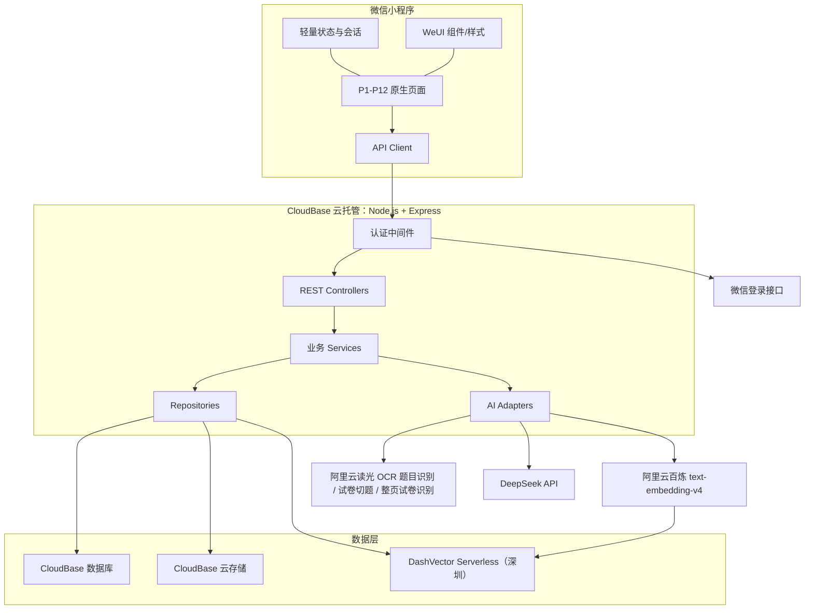
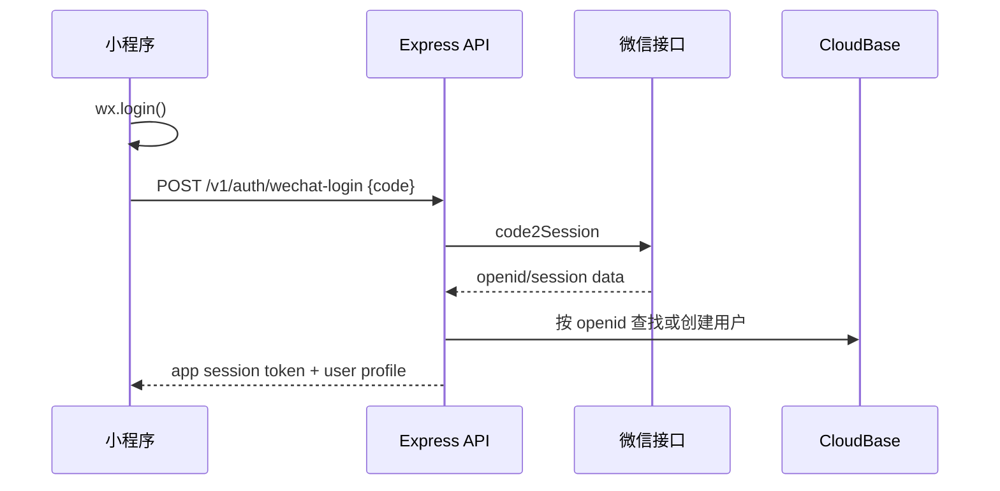
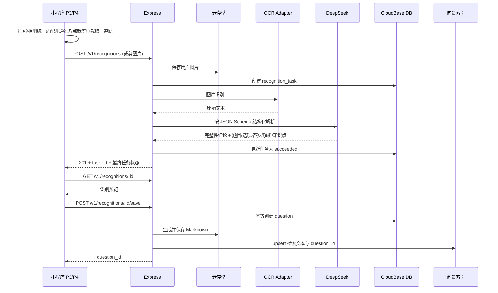
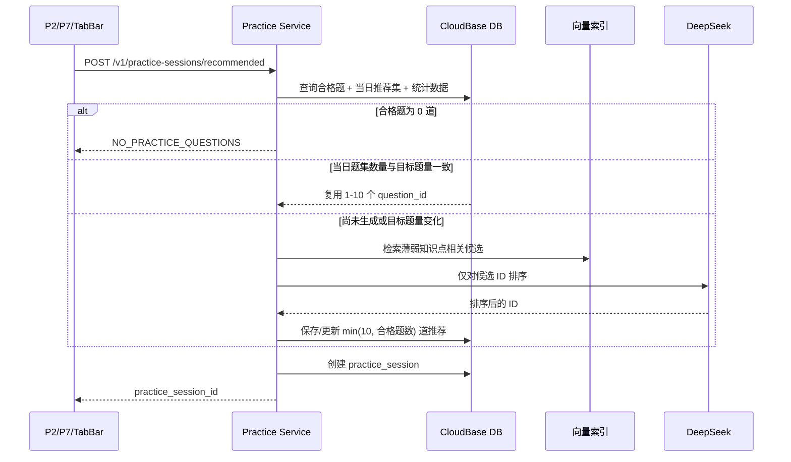

# 《学霸省题》技术架构文档

> 文档版本：v1.2（数学公式识别增强版）  
> 编制日期：2026-08-24  
> 关联文档：`docs/产品需求文档.md`  
> 技术约束：微信小程序原生 + WeUI、Node.js + Express.js、CloudBase、DeepSeek、微信授权登录

## 1. 架构目标与边界

本架构服务于 PRD 中的 12 个页面和五条业务链路：登录、错题收集、题库与搜索、推荐练习、学习复盘。设计遵循前后端分离和最小实现原则。

本期不设计独立后台、微服务拆分、消息队列平台、监控平台、限流平台、多端适配或部署流水线。后端保持单体 Express 应用，通过模块边界隔离业务。

## 2. 关键技术事实与决策

### 2.1 DeepSeek 图片输入限制

截至本文编制日，DeepSeek 官方 Chat Completion 文档中的用户消息内容为文本，官方模型集成信息也将输入标为 `text`，没有声明图片输入。因此“图片直接交给 DeepSeek OCR”不能作为可落地假设。

架构将图片识别拆成两步：

1. OCR 适配器：图片 → 原始文本。
2. DeepSeek 适配器：原始文本 → 结构化题目、解析、易错点和知识点。

OCR 提供方使用阿里云读光教育场景 OCR。单题裁剪调用 `RecognizeEduQuestionOcr`；批量试题识别并行调用 `RecognizeEduPaperCut` 和 `RecognizeEduPaperOcr`：试卷切题结果提供题目边界、坐标和 LaTeX 数学公式，整页试卷结果作为第二路校对文本。适配器会按连续题号和横向对齐关系审核切题数，当切题结果漏掉某题时，从整页 OCR 中恢复缺失题块。对无题号的口算网格，适配器会先合并被 OCR 拆开的等号和括号碎片，再按每个完整算式建立独立题块。切题接口未开通、调用失败或未返回题目结构时，自动使用整页结果回退。适配器将读光 `prism_wordsInfo` 坐标归一化，并通过纵坐标容差聚合同一行后按横坐标排序，避免双栏选项因微小纵向偏差发生 B/A、D/C 错序。DeepSeek 对普通题的两路结果逐符号比对，且不允许将 OCR 已确认的多个题块合并；口算题则由服务端逐式计算，避免模型归并。无法消解的正负号冲突会将该题标记为不可保存。

小程序通过全局 `math-text` 组件渲染结构化公式：移除 `$` 定界符，将 `\\times`、`\\sqrt`、`\\frac`、上下标和角度命令分别显示为乘号、根式、竖式分数及上下标。识别预览、题目详情、练习和练习结果复用同一组件，数据库仍保留原始 LaTeX，避免展示格式反向污染搜索和导出数据。

### 2.2 后端运行形态

使用单个 Node.js + Express.js 服务，推荐运行在 CloudBase 云托管。微信小程序通过 `wx.cloud.callContainer` 或 HTTPS 调用后端 API，业务数据写入 CloudBase 数据库，文件写入 CloudBase 云存储。

选择理由：Express 服务符合技术要求；云托管支持完整 Node.js Web 应用，并能靠近 CloudBase 数据库与存储；前端不直接执行业务数据库写操作。

### 2.3 向量检索

CloudBase 数据库是业务事实数据源。语义检索索引已确认迁移到阿里云 DashVector Serverless（深圳），只保存题目 ID、向量、`user_id`、`subject` 与 `question_type` 元数据，不保存独立业务真相。

向量由阿里云百炼 `text-embedding-v4` 生成，维度固定为 1024。该模型覆盖中英文等多语言，匹配本项目数学与英语题目的检索范围。向量模型或维度修改时必须新建 Collection 并全量重建索引，不可在旧 Collection 中混用。

## 3. 总体架构



## 4. 前端架构

掌握状态使用全局语义色，禁止页面自行定义近似色：`未掌握 = #ff8a1c`（橙色）、`已掌握 = #08bbaa`（青绿色）。筛选项、题目卡片、状态图例、详情页状态操作和个人统计均复用 `app.wxss` 中的 `--status-unmastered`、`--status-mastered` 变量。

### 4.1 技术栈

- 微信小程序原生 WXML、WXSS、JavaScript。
- WeUI 小程序组件库。
- 微信原生能力：`wx.login`、相机/相册选择、Canvas/图片裁剪、云托管或 HTTPS 请求。
- 不引入 React、Vue、Taro、uni-app 或全局重量级状态库。

### 4.2 建议目录

```text
miniprogram/
├── app.js
├── app.json
├── app.wxss
├── custom-tab-bar/
├── pages/
│   ├── login/                 # P1
│   ├── home/                  # P2
│   ├── crop/                  # P3
│   ├── recognition/           # P4
│   ├── question-list/         # P5
│   ├── question-detail/       # P6
│   ├── smart-search/          # P7
│   ├── practice/              # P8
│   ├── practice-result/       # P9
│   ├── practice-history/      # P10
│   ├── mastery/               # P11
│   └── profile/               # P12
├── components/
│   ├── question-card/
│   ├── subject-switch/
│   ├── status-empty/
│   └── loading-state/
├── services/
│   ├── api.js
│   ├── auth.js
│   └── upload.js
├── store/
│   └── session.js
└── utils/
    ├── request.js
    ├── route.js
    └── format.js
```

### 4.3 页面路由与传参

| 页面 | 建议路径 | 主要输入 |
| --- | --- | --- |
| P1 | `/pages/login/index` | 无 |
| P1-A | `/pages/legal/index?type=agreement\|privacy` | 登录前后均可访问的协议正文 |
| P2 | `/pages/home/index` | 当前科目来自本地会话 |
| P3 | `/pages/crop/index` | 无 |
| P4 | `/pages/recognition/index` | `recognition_task_id` |
| P5 | `/pages/question-list/index` | `subject`、`knowledge_point`、`source` |
| P6 | `/pages/question-detail/index` | `question_id` |
| P7 | `/pages/smart-search/index` | `keyword` |
| P8 | `/pages/practice/index` | `practice_session_id` |
| P9 | `/pages/practice-result/index` | `practice_record_id` |
| P10 | `/pages/practice-history/index` | 无 |
| P11 | `/pages/mastery/index` | `subject` |
| P12 | `/pages/profile/index` | 无 |

“练习”导航项使用自定义 TabBar 承担快捷入口行为，并以 `subject=all、mode=comprehensive` 跨数学和英语创建综合练习；首页推荐传入当前 `math/english` 科目及 `mode=recommended`。两个入口分别保存进行中的会话和作答进度，互不覆盖；从综合练习切换到首页推荐时，推荐服务在存在候选题的前提下优先排除综合练习中已经作答的题。创建或恢复对应会话后再进入 P8；如微信 TabBar 路由限制要求配置技术占位路径，该路径只做分发，不构成用户可见产品页面。

### 4.4 页面标题规范

| 页面 | 用户可见标题 |
| --- | --- |
| P1 欢迎登录页 | 学霸省题 |
| P2 首页 | 学霸省题 |
| P5 题库列表页 | 我的题库 |
| P8 做题模式页 | 推荐习题 |
| P12 个人中心页 | 学霸省题 |

登录页使用 `assets/login/welcome-clean.jpg` 作为无文字背景插画，标题、功能说明、登录按钮和协议均由 WXML/WXSS 原生渲染，以保证不同分辨率下的文字清晰度；页面 JSON 的 `navigationBarTitleText` 同步使用相同文案，保证系统标题和自定义导航一致。

### 4.5 状态管理

仅维护三类全局状态：

- 登录会话。
- 当前科目。
- 当前未提交练习的 `practice_session_id` 与本地答案草稿。

列表、详情、搜索结果等页面数据由页面自行加载，不建立复杂全局数据层。

### 4.5 请求约定

- 所有业务请求统一通过 `services/api.js`。
- 请求自动携带会话凭证。
- 响应统一处理加载、空数据、业务错误和登录失效。
- 保存和提交按钮在请求期间禁用。
- 练习答案在每次选择后写入本地临时存储；成功提交后清除。

## 5. 后端架构

### 5.1 技术栈

- Node.js LTS。
- Express.js。
- CloudBase `@cloudbase/js-sdk`（内置 Node.js 适配器）与服务端签名组件。
- DeepSeek OpenAI-compatible API。
- 阿里云 OCR Node.js SDK（单题 `RecognizeEduQuestionOcr`；批量优先 `RecognizeEduPaperCut`，整页校对与回退 `RecognizeEduPaperOcr`）。
- 阿里云百炼 OpenAI-compatible Embeddings API。
- 阿里云 DashVector Serverless HTTP API（深圳）。

### 5.2 建议目录

```text
server/
├── src/
│   ├── app.js
│   ├── config/
│   ├── middleware/
│   │   ├── auth.js
│   │   ├── error-handler.js
│   │   └── request-id.js
│   ├── modules/
│   │   ├── auth/
│   │   ├── users/
│   │   ├── recognitions/
│   │   ├── questions/
│   │   ├── search/
│   │   ├── practices/
│   │   ├── mastery/
│   │   └── exports/
│   ├── adapters/
│   │   ├── deepseek.adapter.js
│   │   ├── embedding.adapter.js
│   │   ├── ocr.adapter.js
│   │   ├── vector.adapter.js
│   │   └── storage.adapter.js
│   ├── repositories/
│   ├── shared/
│   └── server.js
├── test/
├── package.json
└── Dockerfile
```

### 5.3 分层职责

| 层 | 职责 | 禁止事项 |
| --- | --- | --- |
| Controller | 参数解析、调用服务、返回 HTTP 响应 | 不直接访问数据库或 AI |
| Service | 业务规则、事务顺序、权限范围、幂等控制 | 不拼接 HTTP 响应 |
| Repository | CloudBase 数据读写 | 不包含页面逻辑 |
| Adapter | DeepSeek、OCR、向量库、存储的外部接口封装 | 不泄漏供应商响应到业务层 |
| Middleware | 登录认证、统一错误、请求标识 | 不处理具体业务 |

## 6. 认证与数据隔离

### 6.1 登录流程



### 6.2 权限规则

- `openid` 只在服务端使用，不由客户端指定。
- 所有题目、识别任务、练习会话、练习记录、统计和导出查询均自动附加 `user_id = currentUser.id`。
- 资源不存在和无权访问统一返回 `404`，避免暴露其他用户资源是否存在。
- DeepSeek API Key、OCR 凭证、CloudBase 管理凭证只存服务端配置。

## 7. 核心业务时序

### 7.1 拍照识别与入库



识别任务采用状态机：`created → processing → succeeded | failed → saved`。OCR 和 DeepSeek 解析在创建识别任务的 HTTP 请求生命周期内完成，服务端写入最终状态后才返回，避免云托管在响应结束后冻结容器 CPU 导致任务永久停留在 `processing`。小程序上传请求超时为 180 秒，服务端仍分别对外部 AI 调用设置超时。保存接口只接受 `succeeded`，重复保存返回同一个 `question_id`。

### 7.2 推荐练习



DeepSeek 返回必须通过白名单校验：只保留输入候选列表中出现的 ID，去重后按序取目标题量；目标题量为 `min(10, 合格题目总数)`。模型返回不足目标题量时使用确定性评分补齐，不使用模型生成题目。

### 7.3 提交与统计

1. 小程序提交 `practice_session_id` 和全部答案。
2. 服务端读取会话中的题目及正确答案，不信任客户端判分。
3. 在一次业务写入中创建练习记录与答题明细、更新题目练习统计和知识点统计。
4. 写入题目与解析快照。
5. 返回 `practice_record_id`，P9 再读取结果详情。

个人中心统计按 `submitted_at` 倒序分页读取当前用户的全部练习记录。连续学习日使用 `Asia/Shanghai` 自然日去重：今天存在记录时从今天向前计数；今天尚无记录但昨天存在时从昨天向前计数；今天和昨天均无记录才归零。这样当天首次打开页面不会在完成练习前错误清空已有连续记录。

## 8. API 设计

### 8.1 通用响应

成功：

```json
{
  "success": true,
  "data": {},
  "request_id": "req_xxx"
}
```

失败：

```json
{
  "success": false,
  "error": {
    "code": "QUESTION_NOT_FOUND",
    "message": "题目不存在"
  },
  "request_id": "req_xxx"
}
```

### 8.2 接口清单

| 方法 | 路径 | 用途 |
| --- | --- | --- |
| POST | `/v1/auth/wechat-login` | 微信登录或创建用户 |
| GET | `/v1/home?subject=` | 首页概览和最近错题 |
| POST | `/v1/recognitions` | 上传裁剪图并创建单题任务；`?mode=batch` 创建整页多题、多题型识别任务 |
| GET | `/v1/recognitions/:id` | 查询识别状态和预览 |
| POST | `/v1/recognitions/:id/retry` | 重新识别同一图片 |
| POST | `/v1/recognitions/:id/save` | 单题幂等保存，或通过 `item_ids` 勾选批量保存 |
| GET | `/v1/questions` | 错题列表与筛选 |
| GET | `/v1/questions/:id` | 题目详情 |
| PATCH | `/v1/questions/:id/mastery` | 更新掌握状态 |
| POST | `/v1/search/questions` | 语义搜索个人错题 |
| POST | `/v1/practice-sessions/recommended` | 创建每日推荐练习 |
| POST | `/v1/practice-sessions/from-questions` | 搜索结果、单题或错题重做创建练习 |
| GET | `/v1/practice-sessions/:id` | 获取做题内容，不返回答案解析 |
| POST | `/v1/practice-sessions/:id/submit` | 提交答案并判分 |
| GET | `/v1/practice-records` | 练习历史与汇总 |
| GET | `/v1/practice-records/:id` | 结果详解 |
| POST | `/v1/practice-records/:id/items/:questionId/self-assess` | 主观题对照参考答案后自评 |
| GET | `/v1/mastery?subject=` | 知识点掌握度 |
| GET | `/v1/profile` | 个人中心数据 |
| PATCH | `/v1/profile` | 修改并保存用户昵称 |
| POST | `/v1/profile/avatar` | 上传并保存用户头像 |
| GET | `/v1/settings` | 获取设置 |
| PATCH | `/v1/settings` | 保存消息通知偏好 |
| POST | `/v1/points/activate` | 主动同意新版规则并开启积分 |
| GET | `/v1/points` | 积分余额、今日任务和连续学习进度 |
| GET | `/v1/points/transactions` | 当前用户的积分流水 |
| POST | `/v1/exports` | 生成并返回个人数据导出文件 |

### 8.3 关键接口约束

- `GET /practice-sessions/:id` 不得返回 `correct_answer`、`analysis`、`error_prone_point`。
- 列表接口统一使用 `cursor` 和 `limit`；默认 `limit=20`。
- `POST /recognitions/:id/save` 和练习提交接口支持 `Idempotency-Key`。
- `POST /search/questions` 的向量检索必须带服务端注入的 `user_id` 过滤条件。

## 9. 数据模型

### 9.1 `users`

| 字段 | 类型 | 说明 |
| --- | --- | --- |
| `_id` | string | 用户 ID |
| `openid` | string | 微信 OpenID，唯一 |
| `nickname` | string | 昵称 |
| `avatar_url` | string | 兼容历史头像地址 |
| `avatar_file_id` | string | 用户主动选择后上传至云存储的头像文件 ID |
| `preferred_subject` | string | `math`/`english` |
| `notification_enabled` | boolean | 消息通知偏好 |
| `created_at`/`updated_at` | date | 时间戳 |

### 9.2 `recognition_tasks`

| 字段 | 类型 | 说明 |
| --- | --- | --- |
| `_id` | string | 任务 ID |
| `user_id` | string | 所属用户 |
| `image_file_id` | string | 云存储图片 |
| `mode` | string | `single`/`batch`，历史缺省值按 `single` 处理 |
| `status` | string | `created/processing/succeeded/failed/partially_saved/saved` |
| `raw_text` | string | OCR 原始文本 |
| `ocr_lines` | array | 含稳定行号、置信度和坐标的 OCR 文本行 |
| `ocr_question_blocks` | array | OCR 逐题行范围及原图坐标，用于保留无文字配图 |
| `ocr_figures` | array | OCR 返回的图案区域（如有） |
| `parsed_question` | object | DeepSeek 结构化结果 |
| `parsed_questions` | array | 批量模式的逐题结果、校验状态和来源行范围 |
| `valid_question_count` | number | 可勾选保存的题目数 |
| `saved_items` | array | `item_id` 到已保存 `question_id` 的幂等映射 |
| `ignored_item_ids` | string[] | 用户未勾选的有效题目 |
| `error_code` | string/null | 失败原因码 |
| `question_id` | string/null | 保存后的题目 ID |
| `created_at`/`updated_at` | date | 时间戳 |

### 9.3 `questions`

| 字段 | 类型 | 说明 |
| --- | --- | --- |
| `_id` | string | 题目 ID |
| `user_id` | string | 所属用户 |
| `subject` | string | `math`/`english` |
| `type` | string | 首版固定 `single_choice` |
| `stem` | string | 题干 |
| `options` | object | 2～6 个选项，键按 `A`～`F` 连续编号，如 `{A,B,C}` |
| `correct_answer` | string | 实际选项中的一个键 |
| `analysis` | string | 解析 |
| `error_prone_point` | string | 易错点 |
| `knowledge_points` | string[] | 知识点 |
| `difficulty` | string | `easy/medium/hard` |
| `mastery_status` | string | `unmastered/mastered` |
| `first_mastered_at` | date/null | 首次转为已掌握的不可回退时间，用于积分幂等判定 |
| `source` | string | 首版为 `photo` |
| `image_file_id` | string | 原图/裁剪图 |
| `has_illustration` | boolean | 是否检测到需要保留的原题配图 |
| `question_image_file_id` | string | 从原图裁取的**仅图形**图块；无法干净分离时回退为题目文字+图形的整块 |
| `question_image_source` | string | 题图来源：`ocr_figure` 表示按 OCR 图形矩形定位并在其邻域用像素精确定界，`pixel_detected` 表示无 OCR 图形矩形时由像素扫描定位，`region_fallback`/`full_image_fallback` 表示未能分离而回退的整块；用于排查与测试，不在前端展示 |
| `recognition_task_id` | string | 来源识别批次 ID |
| `recognition_item_id` | string | 批次内的题目项 ID |
| `source_line_range` | number[]/null | 该题在 OCR 文本中的起止行号 |
| `markdown_file_id` | string | 题目 Markdown |
| `practice_count` | number | 累计作答次数 |
| `wrong_count` | number | 累计答错次数 |
| `last_practiced_at` | date/null | 最近练习时间 |
| `created_at`/`updated_at` | date | 时间戳 |

### 9.4 `daily_recommendations`

| 字段 | 类型 | 说明 |
| --- | --- | --- |
| `_id` | string | 推荐 ID |
| `user_id` | string | 所属用户 |
| `subject` | string | 推荐范围：`math`/`english`/`all` |
| `date_key` | string | 用户时区自然日 `YYYY-MM-DD` |
| `question_ids` | string[] | 1–10 道有序题目 ID |
| `created_at` | date | 生成时间 |

唯一约束逻辑：`user_id + subject + date_key`。

### 9.5 `practice_sessions`

| 字段 | 类型 | 说明 |
| --- | --- | --- |
| `_id` | string | 会话 ID |
| `user_id` | string | 所属用户 |
| `subject` | string | 单科科目或综合练习 `all` |
| `type` | string | `recommended/comprehensive/review/search/single` |
| `question_ids` | string[] | 有序题目 ID |
| `status` | string | `active/submitted` |
| `record_id` | string/null | 提交后的记录 ID |
| `created_at`/`submitted_at` | date | 时间戳 |

### 9.6 `practice_records`

| 字段 | 类型 | 说明 |
| --- | --- | --- |
| `_id` | string | 记录 ID |
| `session_id` | string | 来源会话，唯一 |
| `user_id` | string | 所属用户 |
| `subject` | string | 单科科目或综合练习 `all` |
| `type` | string | 练习类型 |
| `total_count` | number | 题数 |
| `correct_count` | number | 正确数 |
| `wrong_count` | number | 错误数 |
| `accuracy` | number | 0—100 |
| `items` | object[] | 题目、答案、解析快照及判分 |
| `submitted_at` | date | 提交时间 |

### 9.7 `knowledge_point_stats`

| 字段 | 类型 | 说明 |
| --- | --- | --- |
| `_id` | string | 统计 ID |
| `user_id` | string | 所属用户 |
| `subject` | string | 科目 |
| `knowledge_point` | string | 知识点 |
| `question_count` | number | 相关错题数 |
| `attempt_count` | number | 作答数 |
| `correct_count` | number | 答对数 |
| `mastery_rate` | number | 0—100 |
| `updated_at` | date | 更新时间 |

### 9.8 积分数据

- `point_accounts` 保存积分余额、累计获取、主动开启时间以及规则/协议版本。
- `point_transactions` 是不可变事实流水，使用“用户 + 规则 + 学习来源”确定性 ID 防止重复发放。
- `point_daily_counters` 按北京时间自然日保存各规则进度和上限。
- 三类数据在同一 CloudBase 事务内更新；学习业务数据先行落库，积分失败不回滚 OCR、错题或练习记录，后续通过确定性对账修复。
- 积分中心首屏的概览、今日任务和最近 5 条流水由 `GET /v1/points` 一次返回；进入个人中心时并行预取完整面板，点击入口复用同一个请求或用户级完整缓存，避免重复查询和半成品页面跳变。
- 积分中心使用与首页一致的自定义 `scroll-view` 下拉刷新；刷新期间保留现有面板，强制获取最新完整数据，并显示加载与完成反馈。
- 历史对账不阻塞积分中心响应，同一账号最多每日调度一次后台幂等对账；连续天数查询按时间倒序扫描并在确认首个断档日后立即停止。

## 10. 索引设计

### 10.1 CloudBase 数据库索引

| 集合 | 索引字段 |
| --- | --- |
| `users` | `openid` 唯一 |
| `recognition_tasks` | `user_id + created_at` |
| `questions` | `user_id + subject + created_at` |
| `questions` | `user_id + mastery_status + created_at` |
| `questions` | `user_id + knowledge_points + created_at` |
| `daily_recommendations` | `user_id + subject + date_key` 唯一逻辑 |
| `practice_sessions` | `user_id + status + created_at` |
| `practice_records` | `user_id + submitted_at` |
| `practice_records` | `session_id` 唯一 |
| `knowledge_point_stats` | `user_id + subject + knowledge_point` 唯一逻辑 |
| `point_accounts` | `user_id` |
| `point_transactions` | `user_id + created_at` |
| `point_transactions` | `user_id + date_key + rule_code` |
| `point_daily_counters` | `user_id + date_key` |

### 10.2 DashVector 索引文档

```json
{
  "id": "question_id",
  "vector": "科目 + 题干 + 选项 + 解析 + 易错点 + 知识点 生成的 1024 维数组",
  "fields": {
    "user_id": "user_id",
    "subject": "math",
    "question_type": "single_choice"
  }
}
```

入库文本由后端组合后交给百炼 `text-embedding-v4`，DashVector 不承担文本模型推理。搜索时必须使用服务端注入的 `user_id` 过滤；科目筛选存在时同时过滤 `subject`。向量结果只返回题目 ID 和相关度，页面展示数据再从 CloudBase 读取。DashVector `cosine` 结果是距离，距离越小越相似；适配器将其换算为 `1 - distance` 后再返回业务层。

搜索服务默认将 DashVector 语义结果与 CloudBase 当前用户题库内的关键词结果去重合并，并返回 `search_mode=hybrid`。语义请求发生非配置类异常时自动重试一次；向量数据库未配置、重试后仍连接失败或检索异常时，自动降级为关键词匹配，返回 `search_mode=keyword_fallback` 与安全的 `degradation_code`。降级结果不得标记为 AI 语义结果。

游客不访问搜索接口：小程序对 8 道内置体验题执行精确关键词匹配，内部标记为 `guest_keyword`，覆盖题干、知识点、选项、解析和易错点。搜索词与体验题均不离开客户端。游客登录成功后使用受限的 `return_to=previous` 导航参数返回搜索页，由页面保留关键词并重新调用登录态语义搜索；该参数不接受任意页面地址。

相关度过滤在服务端完成，避免页面数量、结果列表和基于结果创建的练习范围不一致。关键词结果阈值为 `0.45`，可排除仅有单字符重合（最高 `0.35`）的噪声；语义结果绝对下限为 `0.25`。若语义首条低于 `0.45`，进入弱置信区间，仅保留分数不低于 `max(0.25, topScore - 0.08)` 的候选。阈值来自 `text-embedding-v4 + DashVector cosine` 在当前题库上的校准样本：查询“Day”时正确题为 `0.30`，无关题集中在 `0.16–0.20`。

历史索引重建属于显式运维操作：读取 CloudBase 错题正文，通过百炼生成 1024 维向量，并向 DashVector 写入向量、题目 ID、`user_id`、`subject` 与 `question_type`。脚本不删除 CloudBase 原题，并以 `questions.index_status=ready/failed` 记录逐题结果；涉及既有私人错题重新向外部 AI/向量服务传输时，应在获得明确授权后执行。

## 11. AI 设计

### 11.1 DeepSeek 结构化输出

后端要求 DeepSeek 仅返回 JSON，不接收自由文本作为最终结果。建议 Schema：

```json
{
  "subject": "math",
  "type": "single_choice",
  "stem": "题干",
  "options": {"A": "", "B": "", "C": "", "D": ""},
  "correct_answer": "B",
  "analysis": "解析过程",
  "error_prone_point": "易错点",
  "knowledge_points": ["知识点"],
  "difficulty": "medium"
}
```

服务端校验：

- `subject`、`type`、`difficulty` 必须在枚举内。
- 选项数量为 2～6 个，键必须从 A 开始连续编号且内容非空；正确答案必须属于实际选项。
- 题干、解析、知识点不得为空。
- 首版只接受 `single_choice`。
- 校验失败可进行一次结构修复请求；仍失败则任务标记为失败。

识别任务对前端返回 `stage`、`raw_text`、`parsed_question`、`provider_mode`、`ocr_engine` 与 `deepseek_model`。页面因此可分别展示原始图片、OCR 原文与 DeepSeek 结构化结果，并在本地 Mock 模式下明确提示结果为固定示例。

### 11.2 推荐排序输入输出

输入只包含候选题 ID 与必要特征，不向模型暴露用户身份：

```json
{
  "subject": "math",
  "count": 10,
  "candidates": [
    {
      "id": "q1",
      "wrong_rate": 0.75,
      "days_since_last_practice": 14,
      "knowledge_mastery": 0.45
    }
  ]
}
```

输出仅允许：

```json
{"question_ids": ["q1", "q8"]}
```

### 11.3 确定性兜底排序

当 DeepSeek 超时、返回非法 ID 或不足目标题量时，使用下式在候选集中补齐：

```text
score = 0.45 × 历史错误率
      + 0.35 × 距上次练习时间归一值
      + 0.20 × (1 - 知识点掌握度)
```

此兜底只排序已有题目，不改变产品行为。

## 12. 文件存储设计

```text
users/{user_id}/questions/{question_id}/source.jpg
users/{user_id}/questions/{question_id}/question.md
users/{user_id}/exports/{export_id}/mistake-master.zip
users/{user_id}/recognitions/{task_id}/cropped.jpg
```

- 图片在识别任务创建后即保存。
- 题目保存成功后生成 Markdown 文件。
- 导出文件使用短期可下载链接；不向其他用户公开固定地址。
- 删除功能未在需求中定义，首版不提供用户删除入口。

## 13. 一致性与幂等

- 识别保存：以 `recognition_task_id` 作为业务幂等键。
- 练习提交：以 `practice_session_id` 作为唯一提交键。
- 每日推荐：以 `user_id + subject + date_key` 保证当日一致；目标题量变化时更新该记录。
- 向量索引写入使用 `question_id` upsert；重复写入覆盖同一索引记录。
- 数据库题目创建成功但索引失败时，题目标记 `index_status=failed`；详情和列表仍可读取。可由保存重试流程或 `npm run dashvector:reindex` 全量重建脚本修复。

## 14. 错误码

| 错误码 | 含义 | 前端行为 |
| --- | --- | --- |
| `AUTH_REQUIRED` | 未登录或会话失效 | 返回 P1 |
| `IMAGE_INVALID` | 图片无效 | 返回 P3 重新选择 |
| `OCR_FAILED` | OCR 失败 | P4 显示重新识别 |
| `AI_PARSE_FAILED` | DeepSeek 结构化失败 | P4 显示重新识别 |
| `AI_PARSE_FAILED` | 题型无法归类或结构化字段缺失 | P4 标记该题需重新识别 |
| `QUESTION_NOT_FOUND` | 题目不存在或无权访问 | 返回来源页 |
| `NO_PRACTICE_QUESTIONS` | 当前推荐范围没有可练习错题 | 提示先上传错题 |
| `PRACTICE_ALREADY_SUBMITTED` | 会话已提交 | 进入已有 P9 结果 |
| `VECTOR_SEARCH_FAILED` | 语义搜索失败 | P7 提示重试 |
| `EXPORT_FAILED` | 导出失败 | P12 提示重试 |

## 15. 测试策略

### 15.1 单元测试重点

- AI JSON Schema 校验。
- 推荐候选过滤、去重、白名单和兜底排序。
- 服务端判分与正确率计算。
- 知识点掌握度、累计正确率和连续学习天数口径。
- 权限查询自动注入当前用户 ID。
- 保存与提交幂等。

### 15.2 API 集成测试重点

- 微信登录成功/失败。
- 识别任务全状态机。
- 图片 → OCR → DeepSeek → 题目 → 向量索引完整链路。
- 题库组合筛选与个人数据隔离。
- 搜索元数据过滤。
- 每日推荐首次生成与同日复用。
- 练习提交、结果详情、重做错题和历史记录。

### 15.3 小程序端验收重点

- 12 个页面在不同尺寸设备和安全区下无遮挡。
- 相机权限拒绝、相册取消、上传失败可恢复。
- P8 退出与重新进入时答案草稿不丢失。
- 错误题红色提醒、正确答案和易错点展示明确。
- 自定义 TabBar 的练习快捷入口不产生多余用户页面。

## 16. 实施顺序

1. 项目骨架、登录、公共请求层和 4 项导航。
2. CloudBase 数据模型与题库列表/详情。
3. 拍照、裁剪、识别任务、DeepSeek 解析和保存入库。
4. 推荐会话、做题、服务端判分和结果详解。
5. 智能搜索与向量索引。
6. 练习历史、知识点掌握度和个人中心。
7. 数据导出、协议/隐私内容接入和全流程验收。

## 17. 已确认的技术决策

| 编号 | 决策 | 确认结果 | 落地方式 |
| --- | --- | --- | --- |
| T1 | 图片识别链路 | 阿里云读光试卷切题 + 整页试卷 OCR 并行校对 → DeepSeek 结构化解析 | `RecognizeEduPaperCut` 保留题目边界，`RecognizeEduPaperOcr` 校对细小符号；丢失上标、断裂分式或正负号冲突时禁止保存 |
| T2 | 向量索引 | DashVector Serverless（深圳）+ 百炼 `text-embedding-v4` | 1024 维 `cosine` Collection，按用户元数据隔离检索，全量重建历史题目索引 |
| T3 | 推荐边界 | 只从个人错题库选题，不生成新题 | 底部入口跨科目；1–9 道全部练习，10 道及以上取 10 道，0 道时提示上传 |
| T4 | 科目范围 | 数学和英语 | 全链路使用 `math/english` 枚举 |
| T5 | 数据导出 | 首版保留 | 导出 Markdown 与 PDF 并生成压缩包 |
| T6 | 协议与隐私合规 | 使用正式协议文本和明示同意 | 登录页原生复选框默认未选中；协议可分别打开阅读；登录请求携带同意标记和版本，服务端拒绝未同意请求并记录同意版本与时间 |
| T7 | 后端运行位置 | CloudBase 云托管单体 Express | 小程序经容器调用或 HTTPS 访问 REST API |

## 18. 环境配置

后端通过环境变量接收外部服务配置，不在代码或小程序中保存密钥：

| 变量 | 用途 |
| --- | --- |
| `PORT` | Express 监听端口 |
| `CLOUDBASE_ENV_ID` | CloudBase 环境 ID |
| `CLOUDBASE_API_KEY` | CloudBase 服务端 API Key；未配置时使用显式腾讯云密钥签名 |
| `WECHAT_APP_ID` / `WECHAT_APP_SECRET` | 微信 `code2Session` |
| `APP_SESSION_SECRET` | 应用登录令牌签名 |
| `TENCENT_SECRET_ID` / `TENCENT_SECRET_KEY` | CloudBase 未配置 API Key 时的腾讯云服务端签名凭证，与 OCR 无关 |
| `ALIBABA_CLOUD_ACCESS_KEY_ID` / `ALIBABA_CLOUD_ACCESS_KEY_SECRET` | 阿里云读光 OCR 访问凭证，建议使用最小权限 RAM 用户 |
| `ALIBABA_CLOUD_SECURITY_TOKEN` | 使用 STS 临时凭证时的安全令牌，可选 |
| `ALIYUN_OCR_ENDPOINT` / `ALIYUN_OCR_REGION_ID` | OCR 端点与地域，默认杭州 |
| `ALIYUN_OCR_SINGLE_ACTION` | 单题接口，默认 `RecognizeEduQuestionOcr` |
| `ALIYUN_OCR_PAPER_CUT_ENABLED` / `ALIYUN_OCR_PAPER_CUT_ACTION` | 是否启用批量切题及其接口，默认启用 `RecognizeEduPaperCut` |
| `ALIYUN_OCR_PAPER_ACTION` | 整页试卷校对与回退接口，默认 `RecognizeEduPaperOcr` |
| `ALIYUN_OCR_IMAGE_TYPE` / `ALIYUN_OCR_SUBJECT` | 图片来源和学科提示，默认 `photo` / `default` |
| `ALIYUN_OCR_NEED_ROTATE` | 单题识别是否自动旋转，默认 `true` |
| `DEEPSEEK_API_KEY` | 独立 DeepSeek API 密钥；与 Base URL 配置完整时优先使用 |
| `DEEPSEEK_BASE_URL` | 独立 DeepSeek 兼容 API 根地址，默认 `https://api.deepseek.com` |
| `DEEPSEEK_MODEL` | 默认 `deepseek-v4-flash` |
| `DEEPSEEK_MAX_TOKENS` | 单次结构化解析最大输出，默认 `8192` |
| `AI_REQUEST_TIMEOUT_MS` | 单次 OCR 或结构化请求超时，默认 `90000` 毫秒 |
| `RECOGNITION_TASK_TIMEOUT_MS` | 识别任务超时窗口，默认 `240000` 毫秒 |
| `VECTOR_PROVIDER` | 向量服务商，固定为 `dashvector` |
| `DASHVECTOR_ENDPOINT` | 深圳 DashVector Serverless 集群 Endpoint |
| `DASHVECTOR_API_KEY` | DashVector API Key |
| `DASHVECTOR_COLLECTION` | Collection 名，默认 `questions` |
| `VECTOR_REQUEST_TIMEOUT_MS` | DashVector 与百炼向量请求超时，默认 `12000` 毫秒 |
| `DASHSCOPE_BASE_URL` | 百炼兼容 OpenAI 的 API Host，到 `/compatible-mode/v1` 为止 |
| `DASHSCOPE_API_KEY` | 百炼业务空间 API Key |
| `EMBEDDING_MODEL` | 固定 `text-embedding-v4` |
| `EMBEDDING_DIMENSION` | 固定 `1024` |

开发环境允许使用 `MOCK_EXTERNAL_SERVICES=true` 启用可重复的 OCR、DeepSeek 与向量检索替身，仅用于本地联调和自动化测试；正式环境必须关闭。

DeepSeek 调用按配置优先级选择端点：`DEEPSEEK_API_KEY + DEEPSEEK_BASE_URL` 可用时调用独立服务；否则复用 `DASHSCOPE_API_KEY + DASHSCOPE_BASE_URL` 调用百炼 OpenAI 兼容模式。`DEEPSEEK_MODEL` 在两种模式下均作为聊天模型名称。百炼结构化输出请求会传入 `enable_thinking=false`，避免思考模式与 `response_format=json_object` 冲突。

## 19. 官方资料依据

- [DeepSeek Chat Completion API](https://api-docs.deepseek.com/api/create-chat-completion)
- [DeepSeek API 模型列表](https://api-docs.deepseek.com/zh-cn/api/list-models/)
- [CloudBase 云托管](https://docs.cloudbase.net/run/introduction)
- [CloudBase JS SDK Node.js 服务端接入](https://docs.cloudbase.net/en/api-reference/webv3-next/server)
- [CloudBase 微信小程序访问云托管](https://docs.cloudbase.net/run/quick-start/introduce)
- [阿里云百炼通用文本向量同步接口](https://help.aliyun.com/zh/model-studio/text-embedding-synchronous-api/)
- [DashVector 创建 Collection](https://help.aliyun.com/en/document_detail/2510281.html)
- [DashVector Upsert 文档](https://help.aliyun.com/en/document_detail/2510320.html)
- [DashVector 向量检索](https://help.aliyun.com/en/document_detail/2510319.html)
- [阿里云读光 OCR 教育场景识别](https://help.aliyun.com/zh/ocr/product-overview/education-scenario-recognition-1)
- [阿里云读光试卷切题识别](https://help.aliyun.com/zh/ocr/developer-reference/api-ocr-api-2021-07-07-recognizeedupapercut)
